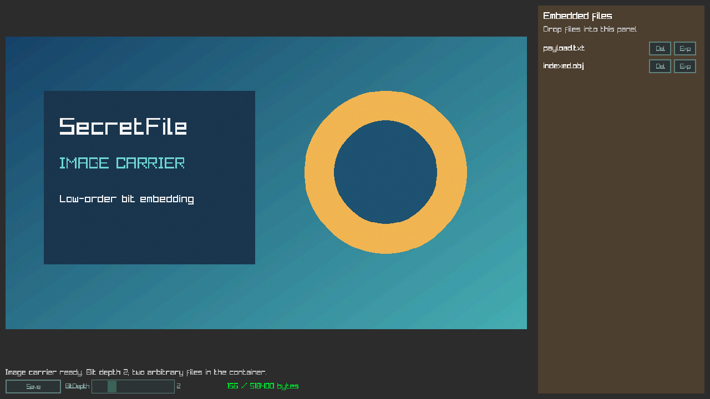

# SecretFile

A C++ steganography / data-embedding experiment that stores multiple arbitrary files in the low-order bits of image pixels, audio samples and 3D vertex data. Built with raylib and raygui, it includes a bit-depth preview for exploring the trade-off between capacity and carrier distortion.



*Actual application rendering with a procedurally generated image carrier, BitDepth 2 and two files in the container.*

## What it does

Load a carrier, choose how many low-order bits to use, preview the changes, then open or create a container. Drop files into the right-hand panel and save a modified carrier. Reopen that output at the same bit depth to recover and export its files.

This is a personal R&D experiment in binary representation and serialization. **It is not encryption and provides no cryptographic protection for sensitive data.**

## Carrier experiments

| Carrier | Verified input | Output | Storage units and limits |
| --- | --- | --- | --- |
| Image | PNG, JPG, JPEG | `<name>_mod.png` | Image converted to RGBA; low bits of each channel byte, depth 1–8 |
| Audio | WAV, mono/stereo; 8/16/32-bit input fixtures | `<name>_mod.wav` | Decoded/converted to 16-bit PCM, preserving channel count and sample rate; depth 1–16 |
| 3D model | OBJ | `<name>_mod.obj` | Low bits of IEEE-754 vertex-position floats; **first mesh only**, including export |

PNG and WAV outputs avoid lossy re-encoding. MP3 is not offered in the UI because its input path has not been validated. Audio format preservation is limited to the normalized 16-bit representation.

## How it works

With one payload bit per byte, only the least significant bit changes:

```text
Original byte:  11010110
Payload slot:   1101011X
```

For a carrier with `N` elements and `B` available bits per element:

```text
capacityBytes = floor(N × B / 8)
```

An image element is one channel byte; an audio element is one 16-bit sample, including each channel; a model element is one 32-bit float component. A 12-bit audio setting, for example, uses a repeating `[8, 4]` byte-depth pattern. `BitStream` traverses those physical byte slots, skipping zero-depth bytes and preserving all other bits.

Bounds checks reject oversized writes and lengths/counts that exceed remaining carrier storage before allocating payload buffers. A container that exactly fills the available capacity is valid.

## Custom multi-file container

All integers are unsigned 64-bit values, serialized **little-endian**. Strings and file data are byte sequences; no compression or encryption is applied.

| Field | Encoding |
| --- | --- |
| Marker | 9 literal bytes: `CONTAINER` |
| File count | 8 bytes |
| Each file's filename length | 8 bytes |
| Filename | The stated number of bytes |
| Data length | 8 bytes |
| File contents | The stated number of bytes |

Total size is `17 + sum(16 + filenameBytes + dataBytes)`. The capacity display and write checks include the marker and every metadata field. The marker identifies the format; it does not authenticate the data or detect all corruption.

## Bit-depth preview

The slider fills the selected low-order bits with pseudorandom preview values. This shows image degradation, audio/waveform changes or geometric distortion before embedding. The preview RNG is a small xorshift generator used for noise.

**BitDepth 0 previews the original carrier only.** Open and Save are disabled/rejected at zero. Change the depth back to the value used when saving before opening an existing container. Actual payloads can produce different distortion from the noise preview.

## Experimental OBJ round-trip

The first mesh's float components act as the carrier. The OBJ exporter writes finite coordinates with `std::numeric_limits<float>::max_digits10` precision and classic-locale decimal formatting. Disk round-trips at depths **1, 2, 4, 8, 12 and 16** verified both the float bytes and recovered multi-file payload through raylib's OBJ loader.

The app works with triangle-expanded OBJ geometry as loaded by raylib. Geometry clones own their buffers and independent default materials; imported material/texture appearance is not preserved by the geometry-only export. High depths can severely distort geometry, and writes producing NaN/Inf coordinates are rejected. Arbitrary re-export, vertex reordering, mesh optimization or editing by another tool can destroy the payload.

## Build and tests

Tested on **Windows x64**, with **Visual Studio 2026 / MSVC 14.50**, **raylib 6.0**, bundled **raygui 4.0**, Premake and **C++17**. The first build downloads the pinned raylib 6.0 release. The Windows script finds an installed Visual Studio C++ toolchain; VS 2022 generation remains available, but that toolchain was not validated here.

Install Visual Studio's **Desktop development with C++** workload and a Windows SDK, then run from the repository root:

```bat
build-VisualStudio2022.bat Debug
build-VisualStudio2022.bat Release
```

The script name is retained for existing workflows; it builds the target and copies runtime resources into `bin/<configuration>/resources/`. Run `bin/Release/SecretFile.exe` from any working directory with that resource folder beside it. The C/C++ runtime is linked statically.

```powershell
powershell.exe -NoProfile -ExecutionPolicy Bypass -File .\test.ps1 -Configuration Debug
powershell.exe -NoProfile -ExecutionPolicy Bypass -File .\test.ps1 -Configuration Release
powershell.exe -NoProfile -ExecutionPolicy Bypass -File .\package.ps1
```

`package.ps1` creates `dist/SecretFile-windows-x64.zip` with the executable, required runtime resources, usage notes and licenses. It excludes PDB/IDB files and static libraries. MinGW generation is retained in `build-MinGW-W64.bat`; MinGW, Linux and macOS builds have not been validated.

Tests use no additional test framework. [Coverage details](tests/README.md) include the standalone bit/container core, PNG/WAV/OBJ disk round-trips, malformed data, output paths and UI resource lifecycle. Debug and Release tests pass; AddressSanitizer also passed for the project's integration code linked against the raylib library.

## Usage

1. Drop a supported carrier into the main view.
2. Set a nonzero **BitDepth**; **Open** reads an existing container or creates an empty one if no marker is found. Malformed marked containers report an error.
3. Drop arbitrary files into the right panel. **Del** removes an entry; the mouse wheel scrolls long lists.
4. **Save** writes `<name>_mod.png`, `.wav` or `.obj` **beside the source carrier**, leaving the source unchanged. Saving again replaces that modified output.
5. Reopen the output at the same depth and press **Exp** to extract an entry into `<carrier-name>_extracted/`, beside the carrier. Stored paths are reduced to a safe filename; existing files/links are refused.

## Limitations

This experiment does not hide or protect its metadata, authenticate contents or provide cryptographic security. Recompression, conversion, editing, resampling and geometry processing can destroy embedded data. A correct marker does not prove that a payload is intact. Audio/model byte traversal currently requires a little-endian host and 32-bit IEEE-754 floats.

Carrier parsing also depends on raylib's format loaders. This is an experimental desktop tool, not a hardened parser or a production security product.

## License and author

SecretFile code: [MIT](LICENSE). Bundled dependencies and assets retain their own terms; see [third-party notices](THIRD_PARTY_NOTICES.md).

Tamás Harsányi — [Portfolio](https://www.tamasharsanyi.hu) · [GitHub](https://github.com/Harsanyi)
